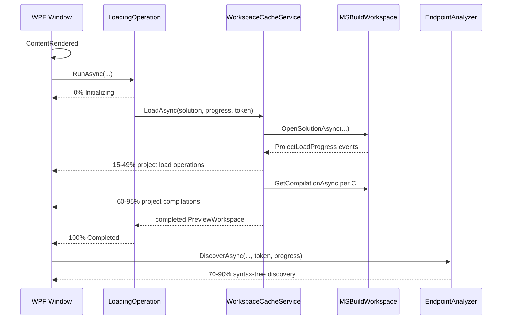

# Project loading

FileCreator is a WPF desktop application. Solution loading begins only after the
main window's first `ContentRendered` event, so WPF can paint and activate the
window before Roslyn or MSBuild work starts. The gRPC generation window follows
the same lifecycle for endpoint discovery.

## Architecture

The loading boundary has three responsibilities:

- `LoadingOperation<TResult>` in `FileCreator.Core.Loading` owns the explicit
  `Idle → Loading → Loaded`, `Failed`, or `Cancelled` state transition. It also
  clamps progress to `0..100`, prevents backwards movement, and publishes a
  result only after success.
- `WorkspaceCacheService.LoadAsync` is the only solution-loading API. It keeps a
  completed `PreviewWorkspace` and swaps it atomically only after a new solution
  has loaded and warmed successfully.
- `PreviewWorkspace.LoadAsync` owns `MSBuildWorkspace`, solution loading, project
  graph construction, and Roslyn compilation warm-up. It has no dependency on
  WPF controls and reports through `IProgress<LoadingProgress>`.

The WPF windows create `Progress<LoadingProgress>` on the UI synchronization
context. Their code-behind updates one centralized overlay state; the loader
never reaches into UI controls.

## Progress phases

Solution loading uses weighted phases backed by real operations:

| Range | Stage | Measurement |
|---|---|---|
| 0-5% | Initialize and locate solution | validation milestones |
| 10% | Create MSBuild workspace | workspace creation milestone |
| 15-49% | Load/evaluate/resolve projects | Roslyn `ProjectLoadProgress` events |
| 50-55% | Complete solution and dependency graph | completed solution/project count |
| 60-95% | Analyze Roslyn compilations | completed C# projects / total C# projects |
| 98-100% | Finalize and publish | successful atomic cache publication |

Endpoint discovery has its own operation because it runs when the gRPC window is
opened:

| Range | Stage | Measurement |
|---|---|---|
| 0-5% | Prepare discovery and acquire workspace | completed milestones |
| 10-65% | Assemble compilation context | completed projects / total projects |
| 70-90% | Discover gRPC endpoints | completed syntax trees / total syntax trees |
| 95-100% | Apply filters and publish endpoints | completed milestones and endpoint count |

Roslyn does not expose byte-level solution progress. The event and item-count
ranges above therefore use weighted phase progress; no timers, random values, or
artificial delays are involved.

The endpoint syntax/semantic scan is the one deliberate `Task.Run` boundary.
After compilation warm-up, Roslyn syntax-root tasks are commonly already complete,
so the remaining traversal is CPU-bound and would otherwise execute inline on the
WPF thread. Roslyn compilations are immutable, and only this analyzer call is moved
to the thread pool; solution I/O continues to use native asynchronous APIs.

## Cancellation

Each window owns a `CancellationTokenSource` for its active operation. The token
flows through `WorkspaceCacheService`, `MSBuildWorkspace.OpenSolutionAsync`,
`Project.GetCompilationAsync`, context construction, syntax-tree reads, semantic
analysis, and endpoint discovery. Cancellation stops further work, does not
publish the partially built workspace or endpoint set, and is presented as a
non-error outcome.

## Roslyn and MSBuild diagnostics

`PreviewWorkspace` registers a workspace-failure handler. Diagnostics are written
with their full context to `System.Diagnostics.Trace` and are shown as details
without being counted as successful progress. Exceptions retain their original
stack traces and propagate to the presentation boundary, where the overlay is
closed and the relevant commands remain disabled.

Compiled projects are cached inside the completed `PreviewWorkspace`. gRPC
context construction reuses those compilations rather than asking Roslyn to
compile the solution a second time. Injecting generated preview documents clears
that compilation cache so later semantic previews cannot consume stale symbols.

## Loading UI state

While an operation is active, the window remains responsive but controls that
depend on a completed project are disabled behind the overlay. The overlay shows
percentage, stage, optional project/file detail, and a cancel button. On success,
the project-dependent commands are enabled together. On failure or cancellation,
no partial result becomes available.

## Extension points

- Add a phase by reporting a `LoadingProgress` from the application or
  infrastructure operation; do not reference a WPF control.
- For a phase with a known collection, map `completed / total` into an allocated
  percentage range.
- Pass the existing cancellation token to every new asynchronous Roslyn, file,
  or analyzer API.
- If a synchronous CPU-only analyzer must be moved off the UI thread, isolate
  only that analyzer call and document why it is safe to run on the thread pool.
- Preserve atomic publication: build a complete result locally and assign it to
  shared application state only after every required phase succeeds.
